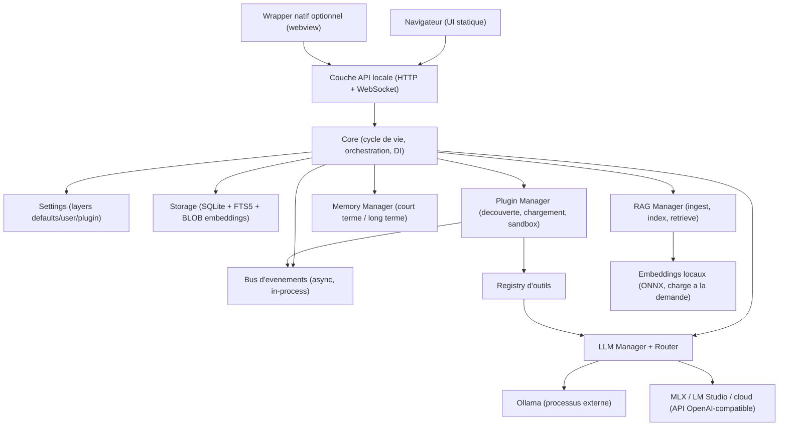

# NURU Lite — Document d'architecture

**Version :** 1.0
**Statut :** Proposition à valider
**Cible matérielle :** MacBook Air/Pro M1 8 Go RAM, machines modestes
**Principes directeurs :** offline-first, léger, rapide, stable, extensible

---

## 0. Synthèse exécutive

NURU Lite n'est pas NURU « amputé » : c'est NURU **repensé autour d'un noyau minimal** et d'une architecture de plugins découplée.

Les 5 décisions structurantes :

1. **Noyau headless en Python asyncio** + UI web statique servie en local. Le noyau est un service léger ; l'UI est un simple navigateur. Découplage total UI/Core.
2. **SQLite comme unique brique de stockage** (conversations, documents, chunks, embeddings, préférences, paramètres). Pas d'ORM, pas de base vectorielle dédiée au démarrage.
3. **Une seule abstraction LLM** : le protocole OpenAI-compatible. Ollama, LM Studio, MLX et le cloud passent par le même client ; le reste est du mappage d'URL.
4. **Lazy loading systématique** : rien n'est importé ni chargé tant qu'il n'est pas utilisé. Le démarrage ne charge que le squelette (Core, Events, Settings, Storage, HTTP).
5. **Un seul agent universel** : la boucle chat + outils. Tous les « agents spécialisés » deviennent des presets de prompt + jeux d'outils (plugins), jamais des processus séparés.

**Objectifs chiffrés (voir §13) :** démarrage < 2 s, RAM au lancement < 300 Mo, RAM normale < 700 Mo, router < 5 ms, recherche documentaire < 500 ms sur corpus personnel.

---

## 1. Vision générale

### 1.1 Philosophie

> « Un noyau qui sait peu, mais qui sait très bien ; tout le reste est un plugin. »

NURU Lite est conçu comme un **assistant personnel local** : il doit répondre vite, travailler hors ligne, et rester prévisible. La lourdeur est l'ennemi n°1 : chaque fonctionnalité ajoutée au noyau augmente le temps de démarrage, la RAM et la complexité de maintenance.

Trois règles d'or :

- **Règle du démarrage** : toute fonctionnalité dont l'import prend du temps ou charge des ressources doit sortir du chemin critique de démarrage.
- **Règle de la RAM** : tout modèle ou bibliothèque lourde (embeddings, OCR, PDF) est chargé uniquement à la demande et libéré dès que possible.
- **Règle de l'extension** : aucune fonctionnalité ne peut être ajoutée en modifiant le noyau ; elle s'ajoute via un plugin, un outil ou un événement.

### 1.2 Ce qui doit absolument être conservé (l'identité)

| Identité de NURU | Traduction en NURU Lite |
|---|---|
| Assistant de conversation | Le chat est l'écran principal, le cœur de l'application |
| Local d'abord | Aucun appel réseau obligatoire ; tout fonctionne offline |
| Modèles locaux et cloud | Une abstraction unique qui couvre Ollama, MLX, LM Studio, OpenAI-compatible |
| RAG personnel | Indexation + recherche + citations, mais simple (SQLite + numpy) |
| Mémoire utilisateur | Préférences et faits stockés localement, réutilisés dans le contexte |
| Extensibilité | Plugins, outils et événements : ajouter sans toucher au noyau |
| Simplicité d'usage | Interface minimale, 3 écrans, zéro configuration obligatoire |

### 1.3 Ce qui est volontairement exclu

- Multi-utilisateurs, synchronisation cloud, comptes.
- Bases vectorielles distribuées, index distribués.
- Orchestration multi-agents lourde.
- Analyse de données / tableaux de bord métriques.
- OCR et analyse d'images dans le noyau (plugins).

---

## 2. Analyse fonctionnelle

Classification de toutes les fonctionnalités envisagées en quatre catégories.

### 2.1 Indispensables (dans le noyau)

| Fonctionnalité | Justification |
|---|---|
| Chat (conversation, historique, streaming) | C'est l'essence du produit |
| Choix du modèle | Nécessaire pour fonctionner avec des modèles locaux ET cloud |
| Streaming des réponses | Expérience de chat indispensable |
| Historique des conversations | Fonctionnalité attendue, coût faible (SQLite) |
| Paramètres | Nécessaire : modèle par défaut, répertoires, thème, langue |
| Import/lecture Markdown + texte brut | Format natif, parsing trivial, coût quasi nul |
| Indexation + recherche vectorielle + recherche texte + citations | Le RAG est la valeur n°2 de NURU, mais **en version simple** |
| Mémoire conversationnelle (contexte récent) | Le contexte court est gratuit (messages en base) |
| Mémoire des préférences utilisateur | Quelques clés/valeurs, coût négligeable, forte valeur |
| Gestion des collections de documents | Liste + suppression suffisent pour la v1 |
| Bus d'événements + gestionnaire de plugins | L'extensibilité est un principe fondateur |

### 2.2 Utiles mais optionnelles (incluses, chargées à la demande)

| Fonctionnalité | Justification |
|---|---|
| Lecture PDF | Fréquent, mais via `pymupdf` (C, rapide), chargé à la demande |
| Lecture DOCX | Format courant, lecteur maison sur zip/XML (~40 lignes) |
| Recherche Web | Utile, mais implique le réseau → outil/plugin par défaut, activable |
| Mémoire long terme (faits auto-extraits) | Grande valeur, mais risque de bruit → **curated** (validée par l'utilisateur) |

### 2.3 À transformer en plugins

| Fonctionnalité | Pourquoi un plugin |
|---|---|
| OCR | Tesseract est lourd (~50 Mo + binaires système) ; usage rare |
| Agents spécialisés (recherche, code, mail…) | Simples presets prompt + outils |
| GitHub, Calendrier, Email, Spotify | Services tiers, API propres, hors périmètre du noyau |
| Voix (TTS/STT) | Modèles lourds et spécifiques plateforme |
| Analyse d'images / vision | Modèles lourds, besoin matériel spécifique |
| Traduction | Combinaison de modèles/outils, orthogonal au noyau |
| Automatisation / workflows | Cas d'usage métier, évolue vite, doit rester isolé |
| Re-ranking (cross-encoder) | Modèle supplémentaire, utile seulement pour gros corpus |

### 2.4 À supprimer complètement (de NURU Lite)

| Fonctionnalité | Justification |
|---|---|
| Multi-utilisateurs / profils multiples | Pas de besoin identifié ; complexité auth/RBAC |
| Synchronisation cloud des données | Contre le principe offline-first |
| Dashboard analytique lourd | Écran inutile pour un assistant personnel |
| Base vectorielle séparée (Chroma/Weaviate/…) | Surdimensionnée pour un corpus personnel |
| ORM complet (SQLAlchemy) | SQLite + couche DAO suffisent |
| Gestion des conversations « à onglets multiples » avancée | Une liste d'historique + recherche suffit |

---

## 3. Architecture cible

### 3.1 Principe global

NURU Lite = **un processus headless** (le noyau Python) qui expose une **API HTTP + WebSocket locale**, plus **une UI web statique** servie par ce même processus. L'utilisateur ouvre `http://localhost:PORT` (ou un wrapper applicatif natif avec webview).

Cette séparation est la décision structurante la plus importante :

- le noyau n'importe **aucune bibliothèque d'UI** (les bindings Qt/GTK pèsent des centaines de Mo et 100+ Mo de RAM) ;
- l'UI est un simple dossier statique, testable, versionnable, remplaçable ;
- les plugins peuvent monter leurs propres panneaux d'UI **sans toucher au noyau** ;
- le streaming se fait proprement par WebSocket/SSE.

### 3.2 Diagramme d'architecture



### 3.3 Responsabilités des modules

| Module | Responsabilités | Anti-responsabilités |
|---|---|---|
| **Core** | Cycle de vie (boot/shutdown), injection de dépendances légère, orchestration des services, configuration du processus, santé | Aucune logique métier ; aucun import de bibliothèque lourde |
| **UI (web statique)** | Rendu, streaming, navigation, saisie, thème | Aucune logique métier ; jamais de connexion directe aux LLM |
| **API** | Routes HTTP (REST) + WebSocket (streaming), validation minimale, sérialisation JSON | Aucune persistance directe ; délègue tout aux managers |
| **LLM** | Protocole `LLMProvider`, clients (OpenAI-compatible, Ollama, MLX), streaming, Router (choix du modèle selon capacité/coût/vitesse) | Ne connaît ni documents ni mémoire |
| **RAG** | Ingest (détection → extraction → chunking → embedding → index), recherche (texte + vectorielle), citations | Ne connaît pas l'utilisateur ; ne choisit pas le modèle |
| **Memory** | Contexte court (N derniers messages), faits/préférences validées, résumés optionnels | N'indexe pas de documents ; pas de graphe |
| **Storage** | Connexion SQLite (mode WAL), migrations, DAO (conversations, messages, documents, chunks, faits, paramètres, plugins), FTS5 | Aucune logique métier |
| **Settings** | Config en couches (défauts < utilisateur < plugin), validation, rechargement à chaud, scopes par plugin | Aucune dépendance aux autres modules |
| **Events** | Bus pub/sub asynchrone typé, hook de cycle de vie, audit léger | Aucune connaissance des émetteurs/récepteurs |
| **Plugin Manager** | Découverte par dossier + manifest, chargement via `importlib`, facade API, cycle de vie, activation/désactivation, sandbox | Ne peut pas importer les internals du noyau |

### 3.4 Choix techniques structurants et compromis

| Décision | Alternative écartée | Pourquoi |
|---|---|---|
| UI web statique servie localement | PySide6/Qt, Tkinter, Flet | Qt = +100-250 Mo RAM et lourdeur de build ; UI web = zéro coût noyau, plugins UI gratuits |
| Python asyncio + HTTP (FastAPI ou aiohttp) | Threads multiples, processus multiples | I/O-bound (réseau LLM, streaming) parfaitement adapté à asyncio ; un seul processus |
| SQLite unique (stdlib) | Postgres, DuckDB, ORM, bases vectorielles | Zéro service, zéro réseau, portable, transactionnel ; FTS5 gratuit |
| Protocole OpenAI-compatible unique | Clients spécifiques par fournisseur | Ollama, LM Studio, vLLM, groq, openai, mlx… exposent tous ce protocole |
| Embeddings locaux via ONNX Runtime | `sentence-transformers` (PyTorch) | PyTorch = ~500 Mo installés, >1 Go RAM chargé ; ONNX = ~10 Mo de lib |
| Recherche vectorielle numpy (+ hnswlib optionnel) | FAISS, Chroma | Corpus personnel ≪ 1 M chunks ; numpy suffit, hnswlib si besoin de montée en charge |

**Compromis assumé :** l'UI web nécessite un navigateur. Pour une expérience « application », on propose un wrapper natif optionnel (pywebview) sans changer l'architecture. Le noyau reste identique.

---

## 4. Chargement intelligent (lazy loading)

### 4.1 Charge au démarrage (chemin critique, < 2 s)

Imports légers uniquement ; tout le reste est différé.

| Composant | Coût estimé | Pourquoi au démarrage |
|---|---|---|
| Core + cycle de vie | ~10 Mo | Squelette |
| Events (bus) | ~1 Mo | Fondation |
| Settings (lecture SQLite/JSON) | ~5 Mo | Indispensable partout |
| Storage (ouverture SQLite, mode WAL) | ~15 Mo | Fondation, connexion paresseuse aux tables |
| Serveur HTTP + servation des statiques | ~30 Mo | Point d'entrée |
| Router (règles de sélection) | ~1 Mo | Décision de sélection de modèle |

**Cible démarrage : 1,2-1,8 s, RAM 120-180 Mo.**

### 4.2 Charge uniquement à la demande (premier usage)

| Composant | Déclencheur | Coût |
|---|---|---|
| Client LLM (HTTP) | Premier message envoyé | ~5 Mo |
| Modèle d'embeddings (ONNX) | Première indexation OU première recherche | ~100-200 Mo (quantifié) |
| Extracteur PDF (`pymupdf`) | Premier PDF importé | ~30 Mo |
| Index vectoriel en mémoire | Première recherche | ~1 Mo / 10 000 chunks |
| Agent/outils réseau (recherche web) | Première invocation | ~2 Mo |

### 4.3 Ne jamais charger automatiquement

| Composant | Raison |
|---|---|
| OCR (Tesseract) | Lourd + binaires système ; plugin désactivé par défaut |
| Modèles d'analyse d'images / vision | Lourds, matériel spécifique |
| Modèles de re-ranking (cross-encoder) | Utile seulement pour gros corpus |
| Résumé long terme automatique | Coûteux en tokens, valeur incertaine → uniquement sur demande |
| Indexation de masse au démarrage | Toujours différée en tâche de fond avec priorité basse |

### 4.4 Stratégie

1. **Imports Python différés** : chaque bibliothèque lourde est importée **dans la fonction** qui l'utilise (`def extract_pdf(...): import fitz`).
2. **Lazy singletons** : les objets coûteux (embeddings, client LLM) passent par un `Registry` qui instancie au premier accès et surveille l'usage.
3. **File de fond priorisée** : ingestion/indexation via `asyncio` avec priorité basse ; le chat passe toujours avant.
4. **Fermeture explicite** : `close()` libère les modèles (option `keep_alive` Ollama, `gc.collect()` après ONNX).

---

## 5. Optimisation mémoire

### 5.1 Estimation par module (M1, cible)

| Module | Idle | Chargé à la demande | Optimisations |
|---|---|---|---|
| Core + Events | 10 Mo | — | Import différé de tout module optionnel |
| Storage (SQLite) | 10-20 Mo | — | `PRAGMA cache_size` réduit (512 Ko), WAL, connexion unique |
| Settings | 2 Mo | — | Chargé une seule fois, snapshot en mémoire |
| Serveur HTTP + statiques | 25-40 Mo | — | Pas de framework UI lourd ; cache statique simple |
| Client LLM (httpx) | 0 | 5 Mo | Pool de connexions réutilisé, fermé en idle |
| Embeddings ONNX (quantifié) | 0 | 80-200 Mo | Modèle quantifié (int8), `close()` après usage batch |
| Index vectoriel (numpy) | 0 | ~1 Mo/10 k chunks | En mémoire seulement pendant la recherche |
| `pymupdf` | 0 | 25-40 Mo | Import dans la fonction, extraction par lots |
| Extractions texte en cache | 0 | 1-2 Mo | Cache disque (pas de RAM) |
| Plugins | 0 | à la charge du plugin | Plugin doit déclarer ses ressources lourdes |

**Total cible : 120-180 Mo au lancement, 200-400 Mo en usage normal, pic < 700 Mo.**

### 5.2 Stratégie de cache

| Cache | Type | Taille max | Éviction |
|---|---|---|---|
| Embeddings des requêtes | LRU mémoire | 512 entrées | LRU |
| Textes extraits des documents | Disque (répertoire cache) | illimité disque, pas de RAM | par horodatage |
| Réponses de recherche identiques | LRU mémoire | 128 entrées, TTL 5 min | LRU + TTL |
| Statiques UI | HTTP | petit | ETag |

### 5.3 Stratégie de libération

1. Après une **ingestion batch** : `del` du modèle d'embeddings, `gc.collect()`, `keep_alive=0` côté Ollama.
2. Après une **session de recherche** : libération de l'index en mémoire si corpus n'a pas changé (rechargé au prochain besoin).
3. **Idle timeout** : 10 min sans usage → fermeture du pool LLM et libération des modèles locaux.
4. **Pression mémoire** : le gestionnaire surveille `psutil` ; si RAM > seuil, ferme les modèles non utilisés et vide les caches LRU.
5. **Zéro RAM résident pour les gros corpus** : les chunks restent sur disque, seule la matrice d'embeddings (compacte) est chargée.

---

## 6. Optimisation CPU

### 6.1 Traitements coûteux identifiés

| Traitement | Coût | Profil |
|---|---|---|
| Streaming des réponses LLM | IO-bound | async |
| Tokenisation / streaming SSE | faible | async |
| Extraction de texte PDF | CPU moyen | `asyncio.to_thread` |
| Chunking | faible | sync rapide |
| Embedding (batch) | CPU/GPU moyen | thread pool + vectorisation |
| Recherche vectorielle (cosine numpy) | CPU faible-moyen | vectorisé, < 500 ms |
| Recherche texte FTS5 | faible | SQLite natif |
| OCR (plugin) | CPU élevé | sous-processus séparé, priorité basse |
| Garbage collection Python | faible-moyen | `gc.freeze()` au démarrage |

### 6.2 Stratégies

1. **Parallélisation**
   - Embeddings par **batch vectorisé** (numpy), jamais boucle Python par chunk.
   - Extraction multi-documents en **thread pool** (max 2-4 threads, GPU partagé).
   - OCR : **sous-processus** pour ne jamais bloquer l'event loop ni faire sauter la RAM du noyau.
2. **Tâches asynchrones**
   - Toute opération réseau (LLM, web) en `async` pur.
   - Les opérations CPU lentes passent par `asyncio.to_thread` pour ne pas bloquer l'event loop.
3. **Traitements différés**
   - Ingestion : tâche de fond priorité basse ; l'UI répond instantanément.
   - Indexation incrémentale : seuls les nouveaux/tués documents sont traités.
   - Résumés long terme : différés à l'idle ou à la demande.
4. **Mise en cache**
   - Résultats d'embedding de requêtes identiques (LRU).
   - Textes extraits (disque), réponses de recherche (LRU court).
   - `gc.freeze()` après boot pour réduire le coût du GC en cours de vie.

**Cible : UI toujours > 45 FPS (de fait, pas de rendu lourd), event loop jamais bloquée > 16 ms.**

---

## 7. Architecture des agents

### 7.1 Principe : un agent universel

NURU Lite n'a qu'**une seule boucle agent** : le chat. Un « agent » n'est pas un processus ni un module, c'est un **preset** : `{nom, prompt système, jeux d'outils, modèle conseillé}`.

```
Boucle universelle :
  Utilisateur -> Contexte (mémoire + RAG le cas échéant) + prompt
              -> Router -> LLM (streaming)
              -> [boucle outil]  si le LLM demande un outil
              -> Réponse -> Historique + mémoire court terme
```

### 7.2 Décisions

| Agent envisagé | Verdict | Justification |
|---|---|---|
| Assistant conversationnel principal | **Indispensable** | C'est le chat ; la boucle universelle |
| Agent de recherche documentaire (RAG) | **Fusionné dans le chat** | Le RAG est un outil déclenché automatiquement (ou un preset) |
| Agent de recherche web | **Plugin / outil** | Nécessite réseau ; outil dans le registry |
| Agent codeur | **Plugin (preset)** | Prompt + outils (exécution locale) |
| Agent email / calendrier / GitHub / Spotify | **Plugins** | Services tiers, API dédiées |
| Orchestrateur multi-agents (AutoGPT-like) | **Supprimé** | Complexité, coût en tokens, bénéfice marginal pour un assistant personnel |
| Agents autonomes en arrière-plan | **Supprimé** | Contre la simplicité ; l'utilisateur reste au centre |

### 7.3 Architecture minimale

- **AgentLoop** : unique boucle (messages + tours d'outils bornés, ex. max 8 tours).
- **Registry d'outils** : `{nom, description, schema, fonction async}`. Les plugins enregistrent leurs outils ici ; le LLM les voit via le prompt système.
- **Presets** : `agents/` en JSON, activables dans l'UI ; un preset = prompt + filtrage d'outils + modèle par défaut.
- **Pas d'état global** : chaque conversation a sa propre stack de contexte.

---

## 8. Architecture RAG

### 8.1 Pipeline (simple et robuste)

```
Import fichier
   -> Détection du type (extension + magic bytes)
   -> Extraction texte  (markdown: natif / txt: natif / pdf: pymupdf lazy / docx: zip+XML maison)
   -> Normalisation    (UTF-8, espaces, marques de paragraphe)
   -> Chunking         (fenêtre glissante ~512 tokens, chevauchement 64, respect des paragraphes)
   -> Embedding        (ONNX local quantifié OU embeddings Ollama, en batch)
   -> Stockage         (table chunks: doc_id, index, texte, métadonnées, page, BLOB embedding)

Requête
   -> Embedding de la requête (même embedder que l'index !)
   -> Recherche hybride :  top-k vectoriel (cosine numpy) + top-k texte (FTS5)
   -> Fusion (RRF : Reciprocal Rank Fusion, 2 lignes) + seuil de pertinence
   -> Contexte (récupération des chunks, borné en tokens)
   -> Citations (doc_id, titre, page/position -> métadonnées du chunk)
   -> Envoi au LLM avec prompt « réponds avec les passages ci-dessus »
```

### 8.2 Choix et suppressions de complexité

| Aspect | Décision | Pourquoi |
|---|---|---|
| Type d'index | SQLite + BLOB embeddings + FTS5 ; cosine numpy | Corpus personnel ; zéro service, zéro dépendance lourde |
| Montée en charge | `hnswlib` en remplacement optionnel au-delà de ~100 k chunks | Même interface, swap transparent |
| Re-ranking | Plugin optionnel (cross-encoder) | Inutile sous ~10 k chunks |
| Citations | Toujours actives (métadonnées du chunk) | Valeur de confiance essentielle |
| Résumés par document | Hors périmètre v1 | Complexité ; ajout plugin possible |
| Ingestion incrémentale | Hash du contenu ; seuls les changements sont re-traités | Évite la ré-indexation complète |
| Multi-collections | Table `collections` + filtre | Suffisant ; pas de schéma vectoriel complexe |

### 8.3 Cible de performance

- Indexation : ~50-200 documents de 10 pages en < 60 s en arrière-plan.
- Recherche sur 10-50 k chunks : **< 300 ms** (dont embedding de requête).
- Répondre « sans corpus » si aucun résultat au-dessus du seuil (éviter les hallucinations RAG).

---

## 9. Architecture mémoire

### 9.1 Mémoires réellement utiles

| Mémoire | Utile ? | Décision |
|---|---|---|
| Court terme (N derniers messages) | **Oui** | Contexte par conversation, limité à N tokens |
| Historique persistant | **Oui** | Tables SQLite `conversations` + `messages` |
| Préférences utilisateur | **Oui** | Table clé/valeur, injectées dans le prompt (langue, ton, modèle préféré, répertoires) |
| Faits long terme | **Oui, mais curated** | Extraction automatique en suggestion ; **validation par l'utilisateur** avant stockage |
| Résumés de conversations | Optionnel | À la demande, différé, coût en tokens |
| Mémoire par agent / par plugin | Plugin | Le plugin gère son propre espace |
| Graphe de connaissances | **Supprimé** | Complexité sans besoin avéré dans l'édition Lite |

### 9.2 Architecture simple

```
tables:
  user_preferences (cle TEXT PK, valeur TEXT, source 'user'|'plugin')
  facts (id, texte, catégorie, statut 'suggestion'|'validée', source, ts)
  conversations (id, titre, modèle, ts, résumé)
  messages (id, conversation_id, rôle, contenu, tokens, ts)
```

**Règle : la mémoire ne charge jamais de modèle.** Elle est purement du SQL + injection de contexte. Le « Memory Manager » calcule le budget de tokens du contexte (système + préférences + faits validés + RAG + historique) et tronque le moins récent en premier.

---

## 10. Interface utilisateur

### 10.1 Principe : trois écrans, une barre latérale

```
+--------------------------------------------------------------+
| [logo]  NURU Lite        (état : local / modèle : mistral-7b) |
|  ________________________  +--------------------------------+
| | Chat                    | |  Messages                       |
| | Documents               | |  [saisie]                       |
| | Historique              | |  (streaming, bouton stop)       |
| | Paramètres              | |                                 |
| +-------------------------+ |  [citations RAG collabées]      |
|                            +--------------------------------+
| [Plugins] (liste active)                                     |
+--------------------------------------------------------------+
```

Navigation : **Chat**, **Documents**, **Historique**, **Paramètres**. Historique = recherche dans la liste + reprise de conversation en 1 clic.

### 10.2 Règles UI

- **Zéro écran inutile** : pas de dashboard, pas de wizard de démarrage, pas d'écran « stats ».
- **Flux unique** : le chat est le point d'entrée ; Documents et Paramètres sont des panneaux.
- **Streaming natif** : WebSocket, rendu incrémental, bouton d'arrêt.
- **Citations intégrées** : réponses RAG avec notes numérotées repliables, clic → document.
- **Performance** : DOM minimal, pas de framework lourd côté client (vanilla JS ou Preact ~4 Ko) ; liste virtuelle pour les historiques longs ; 60 FPS assuré par la légèreté.
- **Fonctionnement hors ligne** : l'UI ne fait aucun appel externe ; tout passe par l'API locale.
- **Clavier d'abord** : raccourcis (nouvelle conversation, focus saisie, recherche).

### 10.3 Plugins UI

Les plugins peuvent monter des panneaux : ils déposent des fichiers statiques sous `/plugins/<id>/` et déclarent un point de montage (`/plugins/<id>/index.html`). Le noyau sert ces fichiers, l'UI affiche le panneau si présent. **Aucune modification du noyau requise.**

---

## 11. Dépendances

### 11.1 Remplacements proposés

| Dépendance lourde (NURU complet) | Alternative NURU Lite | Gain |
|---|---|---|
| PySide6 / PyQt6 (UI native) | UI web statique + FastAPI/aiohttp | -150-400 Mo installés, -100+ Mo RAM |
| `sentence-transformers` + PyTorch | `onnxruntime` + modèle quantifié (ou embeddings Ollama) | -400 Mo installés, -800 Mo RAM pic |
| SQLAlchemy (ORM) | stdlib `sqlite3` + couche DAO | -20 Mo, moins d'abstraction |
| ChromaDB / FAISS | numpy + SQLite (hnswlib optionnel) | -200 Mo+, zéro service |
| `requests` | `httpx` (async) | uniformité async, pooling |
| `pdfplumber` + `PyPDF2` | `pymupdf` seul | une seule lib C, 5-10x plus rapide |
| `python-docx` | lecteur maison (zipfile + xml.etree) | zéro dépendance |
| `pydantic` (v1 lourd) | `dataclasses` + validators maison | -10 Mo, plus léger |
| Full React/Vue bundle | vanilla JS / Preact (~4 Ko) | chargement UI quasi instantané |
| `tesseract` (OCR) | plugin désactivé par défaut | hors noyau |
| `pandas`/`polars` | inutile (SQLite suffit) | suppression |

### 11.2 Dépendances cibles du noyau (estimées)

- `httpx` (HTTP async, streaming SSE)
- `fastapi` + `uvicorn` (ou `aiohttp` — choix à arbitrer ; FastAPI = vitesse de dev)
- `onnxruntime` (embeddings locaux, chargé à la demande)
- `pymupdf` (PDF, chargé à la demande)
- `numpy` (cosine, chargé à la demande)
- stdlib : `sqlite3`, `asyncio`, `zipfile`, `xml.etree`, `json`, `importlib`, `gc`, `threading`

**Soit ~4-6 dépendances « actives », tout le reste est stdlib ou chargé à la demande.** L'install total reste sous ~120 Mo disque (hors modèle de langage).

---

## 12. Plugins

### 12.1 Découplage total

Un plugin n'a **jamais** accès aux internals du noyau. Il reçoit une **facade** (`PluginAPI`) à l'activation, avec des capacités limitées et déclarées.

### 12.2 Cycle de vie


### 12.3 Manifest

```json
{
  "id": "web-search",
  "version": "1.0.0",
  "entry": "main.py:register",
  "permissions": ["network", "ui:panel"],
  "heavy_resources": ["tesseract"],
  "enabled": true
}
```

### 12.4 Communication avec le Core

| Mécanisme | Usage |
|---|---|
| **Événements** (bus pub/sub) | Écoute passive : `documents.imported`, `message.created`, `settings.changed` |
| **Outils** (registry) | Le LLM peut invoquer `plugin.web_search("...")` ; schéma déclaré |
| **Commandes** | Invocations directes depuis l'UI ou la boucle agent |
| **Routes HTTP dédiées** | `/plugins/<id>/...` (statiques + endpoints) |
| **Storage dédié** | Table préfixée `plugin_<id>_*`, isolée |

### 12.5 Désactivation

1. **Déclarative** : `enabled: false` dans le manifest ou `settings.plugins.<id>.enabled = false`.
2. **Noyau** : le Plugin Manager ne charge jamais un plugin désactivé ; ses outils/routes ne sont pas enregistrés ; ses ressources lourdes ne sont jamais importées.
3. **À chaud** : désactivation → suppression des outils/écouteurs/routes, fermeture des ressources, `gc.collect()`.
4. **Échec de chargement** : le plugin est marqué `error` dans l'UI, le noyau continue de fonctionner (isolation par `try/except` + log).

### 12.6 Sécurité (règles)

- Permissions explicites dans le manifest, affichées à l'utilisateur.
- Plugins non signés/du dossier utilisateur : exécution dans le même processus **mais** avec la facade réduite ; recommandation future : `subprocess` + IPC pour les plugins réseau/lourds.
- Chaque plugin déclare ses « heavy_resources » afin que le noyau ne les charge que si le plugin est activé.

---

## 13. Performances

### 13.1 Objectifs chiffrés

| Métrique | Objectif | Moyen technique principal |
|---|---|---|
| Démarrage | **< 2 s** (froid), < 0,5 s (chaud) | Imports différés, `gc.freeze()`, aucun modèle chargé au boot |
| RAM au lancement | **< 300 Mo** (cible 150-180) | Pas de lib UI, SQLite WAL cache réduit, zero heavy import |
| RAM en usage normal | **< 700 Mo** | Lazy loading, idle timeout, libération explicite des modèles |
| Router (choix modèle/outil) | **< 5 ms** | Règles locales en mémoire, zéro réseau |
| UI | **60 FPS** | DOM minimal, streaming WebSocket, liste virtuelle |
| Recherche documentaire | **< 500 ms** sur corpus perso | numpy vectorisé + FTS5 + RRF, embeddings en cache |
| Première réponse LLM | **< 300 ms** (hors inférence) | Pool httpx réutilisé, streaming SSE |
| Streaming | continu sans à-coups | async pur, backpressure |

### 13.2 Moyens techniques pour atteindre ces objectifs

1. **Import différé systématique** : mesuré par `--timing` au boot (chaque module reporte son temps).
2. **`gc.freeze()`** après initialisation : réduit le GC durant la session.
3. **SQLite WAL + `cache_size` réduit** + `synchronous=NORMAL` : rapidité d'écriture sans perte de fiabilité locale.
4. **Pool httpx unique** réutilisé par tous les providers LLM.
5. **Embeddings quantifiés (int8)** : ~80-120 Mo au lieu de 300+.
6. **Index vectoriel en RAM seulement pendant la recherche**, jamais résident.
7. **Surveillance active** : `psutil` + logs `ram`, `cpu`, `latence` en mode debug ; budgets exposés dans Paramètres.
8. **Benchmarks d'intégration** (startup, recherche, streaming) dans la CI pour détecter toute régression.

---

## 14. Comparaison NURU complet vs NURU Lite

| Critère | NURU complet | NURU Lite |
|---|---|---|
| Complexité | Élevée (UI native + services + ORM + vector DB) | Faible (1 processus, SQLite, UI web) |
| Consommation RAM | 800 Mo - 2 Go (UI native + PyTorch + DB) | 150-400 Mo (pic < 700 Mo) |
| Vitesse de démarrage | 4-10 s | < 2 s |
| Espace disque installé | > 1,5 Go | < 150 Mo (hors modèles) |
| Maintenabilité | Faible (couplage fort, modules interdépendants) | Élevée (contrats explicites, événements, plugins) |
| Évolutivité | Par refactoring du noyau | Par ajout de plugins/outils sans toucher le noyau |
| Facilité de développement | Moyenne (stack lourde) | Élevée (stdlib, tests unitaires rapides) |
| Charge cognitive pour l'utilisateur | Moyenne-élevée | Faible (3 écrans) |
| Risque de régression | Élevé | Faible (surface d'API réduite) |
| Offline-first | Parcellaire | Garanti (aucun appel réseau obligatoire) |

**Gains estimés de NURU Lite :**
- RAM : **-60 à -80 %**
- Démarrage : **-70 à -80 %**
- Disque : **-85 à -90 %**
- Maintenabilité : surface de code du noyau réduite d'au moins **50 %** (estimation)
- Temps de cycle de développement d'une fonctionnalité : divisé par 2-3 (plug-in au lieu de refactoring)

---

## 15. Feuille de route

### P0 — Squelette (Fondations)

- **Objectifs** : noyau headless qui démarre < 2 s, chat fonctionnel avec un modèle OpenAI-compatible (Ollama/LM Studio/cloud), streaming, historique, paramètres.
- **Livrables** : Core, Events, Settings, Storage (SQLite + migrations), API HTTP/WebSocket, UI Chat minimale, protocole `LLMProvider` + OpenAI-compatible + Ollama, Router v1.
- **Dépendances** : aucune externe (hors httpx/fastapi).
- **Risques** : scope creep sur l'UI ; choix UI web rejeté par l'équipe → à trancher tôt (preuve de concept en une journée).
- **Gains attendus** : socle stable, mesures de démarrage/RAM dès P0.

### P1 — RAG + Mémoire (Valeur cœur)

- **Objectifs** : ingestion PDF/MD/TXT/DOCX, indexation incrémentale, recherche hybride + citations, embeddings locaux (ONNX) ou Ollama, mémoires court terme + préférences, lazy loading complet.
- **Livrables** : RAG Manager, chunker, embedder, FTS5, RRF, UI Documents, injection mémoire, surveillance RAM/CPU.
- **Dépendances** : P0.
- **Risques** : taille du modèle d'embeddings sur 8 Go ; qualité du chunking (règle simple + tests) ; temps de première indexation.
- **Gains attendus** : la valeur n°2 du produit (recherche < 500 ms) sans exploser la RAM.

### P2 — Extensibilité (Plugins + outils)

- **Objectifs** : système de plugins v1 (manifest, facade, événements, outils, routes UI, désactivation à chaud), outils web-search et exécution de commandes (presets), gestion des modèles dans l'UI.
- **Livrables** : Plugin Manager, PluginAPI, Registry d'outils, presets d'agents, UI Paramètres (modèles, plugins).
- **Dépendances** : P1.
- **Risques** : sécurité des plugins (permissions, sandbox) ; API d'outils trop large → vider le périmètre ; plugins qui chargent des ressources lourdes à l'insu du noyau.
- **Gains attendus** : toutes les futures fonctionnalités deviennent des plugins ; le noyau ne grossit plus.

### P3 — Performance, packaging, polissage

- **Objectifs** : durcir les objectifs (RAM, startup), OCR + vision + voix en plugins, MLX provider, packaging natif (launcher), benchmarks CI, documentation.
- **Livrables** : audit de performance complet, tests de non-régression, installer macOS (app + wrapper webview optionnel), plugins officiels (OCR, vision, web).
- **Dépendances** : P2.
- **Risques** : wrapper natif vs navigateur (décision utilisateur) ; `hnswlib` si montée en charge ; fragmentation des plugins.
- **Gains attendus** : produit final léger, stable et démontrable : **démarrage < 2 s, RAM < 700 Mo, recherche < 500 ms**.

---

## Annexes

### A. Analyse critique du projet

- **Force** : la vision (offline-first, local, extensible) est cohérente ; le catalogue de fonctionnalités est réaliste.
- **Risque principal** : le glissement progressif vers la lourdeur — c'est exactement ce que l'édition Lite combat. La discipline « plugin > noyau » doit être appliquée dès P0, pas après.
- **Danger identifié** : chaque « petite » bibliothèque ajoutée au noyau (UI, ORM, vector DB, OCR…) coûte 50-500 Mo de RAM et 1-5 s de démarrage. Toutes les décisions de dépendance doivent passer par la grille du §11.
- **Recommandation** : imposer des **benchmarks de non-régression** (startup, RAM, recherche) dans la CI dès P1.

### B. Décisions prioritaires (dans l'ordre)

1. UI web servie localement (et non Qt/Tk). — Décision structurante n°1.
2. SQLite unique, sans ORM, sans vector DB au départ.
3. Protocole OpenAI-compatible comme seul contrat LLM.
4. Lazy loading systématique dès P0 (mesuré par des logs `--timing`).
5. Un seul agent universel + presets.
6. Plugins découplés via facade + événements (dès P2, pensé dès P0).

### C. Risques globaux et parades

| Risque | Parade |
|---|---|
| RAM excessive (embeddings + LLM simultanés) | Budget de ressources, idle timeout, fermeture explicite, `keep_alive` Ollama |
| Complexité du RAG | Pipeline linéaire, RRF, pas de re-ranking obligatoire |
| Sécurité des plugins | Permissions déclaratives, facade réduite, désactivation à chaud, sandbox futur |
| Dépendance à un seul fournisseur LLM | Abstraction `LLMProvider` ; le protocole OpenAI-compatible est ubiquitaire |
| Dérive du périmètre | Règles « plugin > noyau » + revue de chaque ajout de dépendance |
| Perte de la compatibilité Mac M1 | Cible asyncio + numpy + onnxruntime : toute la stack est multi-plateforme |
